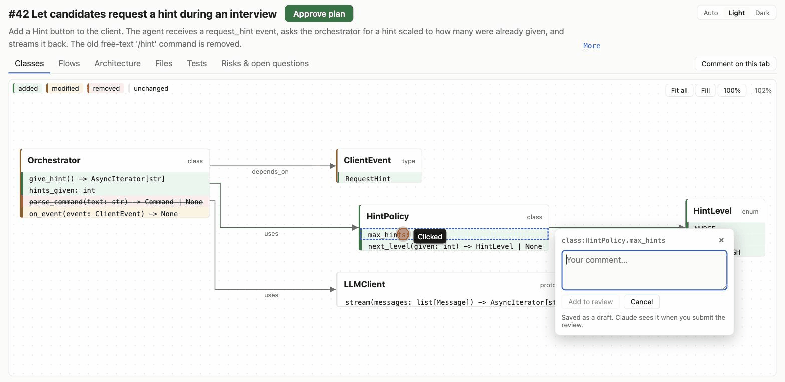
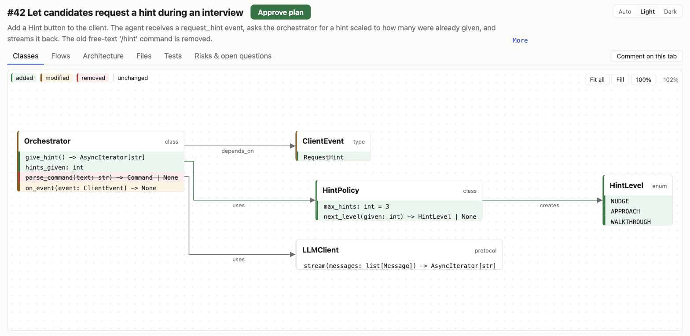
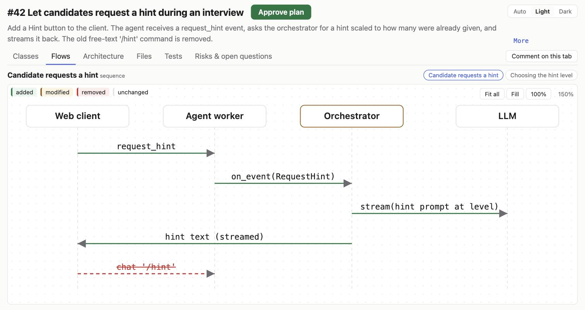
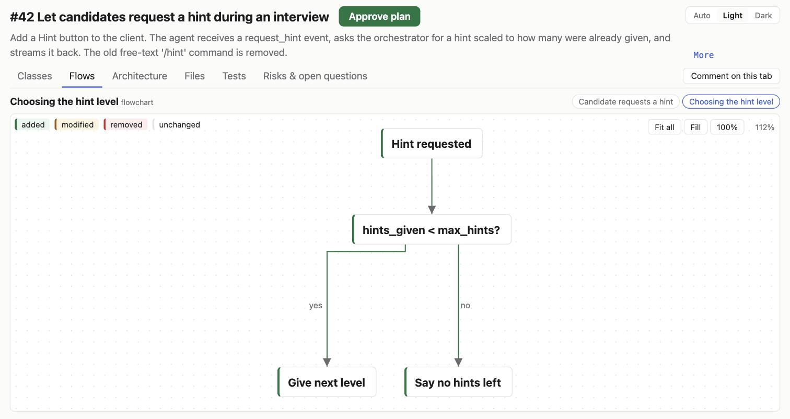
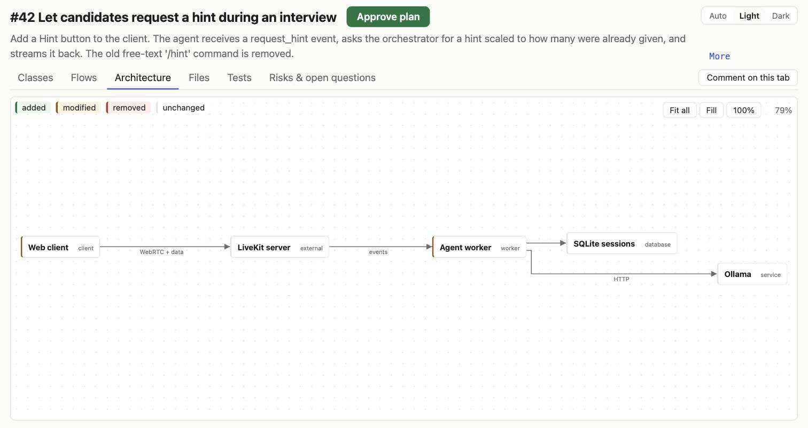
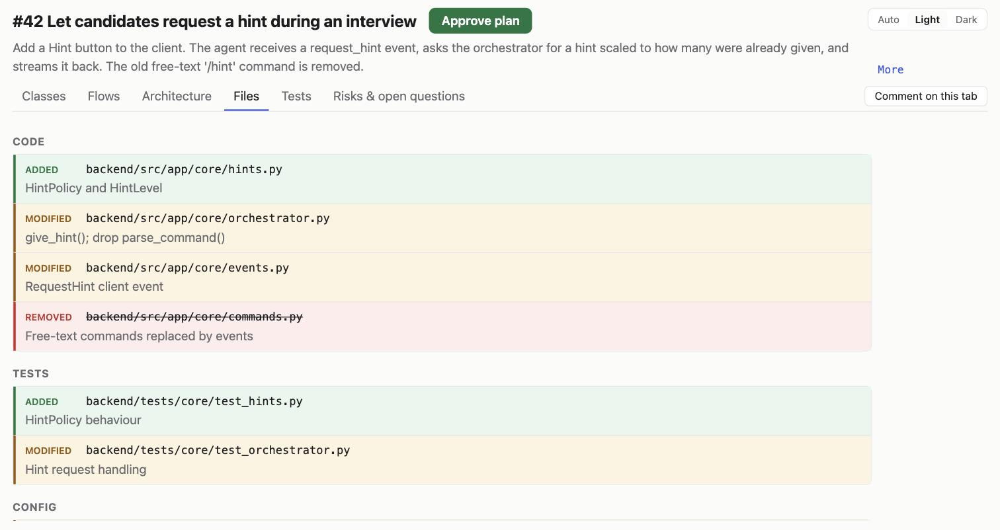
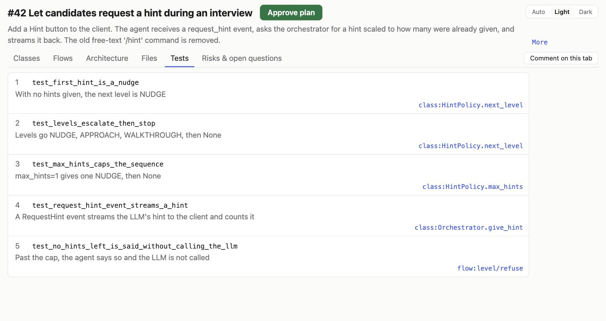
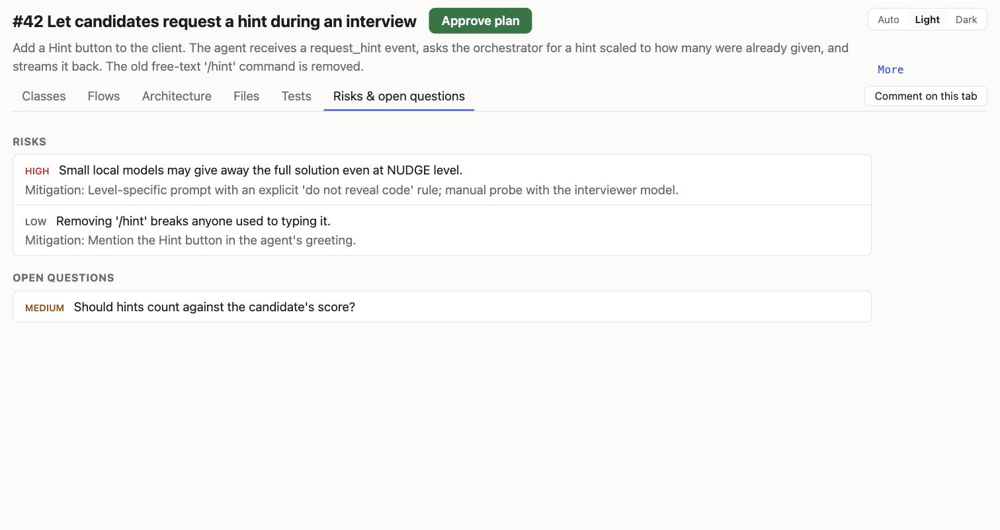

# claude-workbench

**See your coding agent's plan as diagrams before it writes any code.** plan-review is a Claude Code plugin: an agent plans an issue from your tracker (or a plain prompt), and the plan opens in your browser as interactive diagrams of classes, flows, architecture, files, tests and risks. Click anything to comment. Claude answers or revises the plan and the page updates live. When you approve, agents implement it with TDD and review the result.



> Status: v0.1, public and installable. Built and dogfooded by one developer, so expect rough edges; [issues](https://github.com/Selimmo/claude-workbench/issues) welcome.

## Who it's for

Developers who use Claude Code for multi-file changes and want to steer the design before the code exists, rather than review a large diff afterwards. The full pipeline takes a GitHub issue, a Jira or Linear issue, or a plain prompt; the viewer on its own needs nothing but a `plan.json`.

## Prerequisites

- macOS, Linux, or Windows with [Git for Windows](https://gitforwindows.org/) (Claude Code's Bash tool on Windows)
- [Claude Code](https://claude.com/claude-code) v2.1.292 or later
- `git`: Claude Code clones the marketplace from GitHub
- [uv](https://docs.astral.sh/uv/) 0.13.0 or later (Python 3.15 is downloaded automatically)
- For GitHub issues in the pipeline: [`gh`](https://cli.github.com/), logged in with `gh auth login`, to read the issue

## Try it

Install the plugin, then run `/reload-plugins` in any open Claude Code session (or start a new one):

```bash
claude plugin install plan-review --marketplace Selimmo/claude-workbench
```

**Without an issue: just the viewer.** The plugin puts `plan-review` on Claude Code's PATH. In a Claude Code session in any folder, load the sample plan in bash mode (start each line with `!`):

```bash
plan-review init 42
curl -fsSL https://raw.githubusercontent.com/Selimmo/claude-workbench/main/plugins/plan-review/examples/plan.json -o .claude/work/42/plan.json
```

Then ask Claude to *run `plan-review serve 42` in the background*; it keeps running and opens the viewer in your browser. Comment on anything and submit the review; `plan-review threads 42` shows what Claude would read. Any valid `plan.json` works, whoever wrote it ([format](plugins/plan-review/README.md#the-plan-format-planjson)).

**With an issue or a prompt: the whole pipeline.** In a project, run `/plan-review:ship` with a GitHub issue number or link, a Jira or Linear link or key (through your Claude Code connector for it), or a plain prompt. Only GitHub issues and prompts are proven end to end. For example:

```
/plan-review:ship 42
```

The architect plans issue #42 and the plan opens as diagrams. Comment, submit your review, and Claude answers or revises. Approve it, and agents implement it with TDD and review the result. Nothing is committed without your OK.

Upgrade with `plan-review upgrade`, or turn on marketplace auto-update. See [plan-review's README](plugins/plan-review/README.md) for every command, the `plan.json` format, the agents and the project settings.

## What a plan looks like

Every tab of the [sample plan](plugins/plan-review/examples/plan.json). Elements are coloured by whether the plan adds, modifies or removes them, and each one can be commented on.

**Classes**: the types and functions the change touches, with their members as signatures.



| | |
|---|---|
| **Flows**: sequence diagrams…  | …and flowcharts.  |
| **Architecture**: the components and how they talk.  | **Files**: what is added, modified or removed, and why.  |
| **Tests**: the planned tests, in TDD order, each tied to what it covers.  | **Risks & open questions**, with mitigations.  |

## What it can touch

plan-review runs inside your Claude Code session, under your permission settings: anything an agent does through Bash or file edits goes through the same approval prompts as the rest of your session.

- **The viewer** is a local server bound to `127.0.0.1` on a random port. It reads and writes only `.claude/work/<id>/` in your project (the plan, comment threads, drafts, approval, and the grill's `grill.json` and `grill_drafts.json`), plus a `.claude/work/.gitignore` that keeps it all out of git. It has no authentication, and cross-site requests to it are not blocked yet ([#36](https://github.com/Selimmo/claude-workbench/issues/36)).
- **Your tracker**, read once at the start: `/ship` reads the issue through your logged-in `gh` (GitHub) or the Jira or Linear connector you set up in Claude Code. Nothing is written to the tracker: no comments, no status changes.
- **Git**: `/ship` creates a branch and commits only after your explicit OK. It never pushes, opens a PR or merges unless you ask.
- **Agents**: all four can read your project and run shell commands, so your permission prompts are the real limit. The architect is told to write only `plan.json`, but has a Write tool. The implementer edits files and runs your configured checks. The two reviewers have no edit tools, and `/ship` discards any review that changed a file.

## Roadmap

plan-review is the first plugin here; the aim is a set of tools that take an issue to a reviewed commit with agents. Next for plan-review: see the [open issues](https://github.com/Selimmo/claude-workbench/issues).

## More

- [CHANGELOG.md](CHANGELOG.md): what changed in each release
- [CONTRIBUTING.md](CONTRIBUTING.md): build, test and change the plugins
- [RELEASING.md](RELEASING.md): cutting a release (maintainers)

## License

[MIT](LICENSE)
