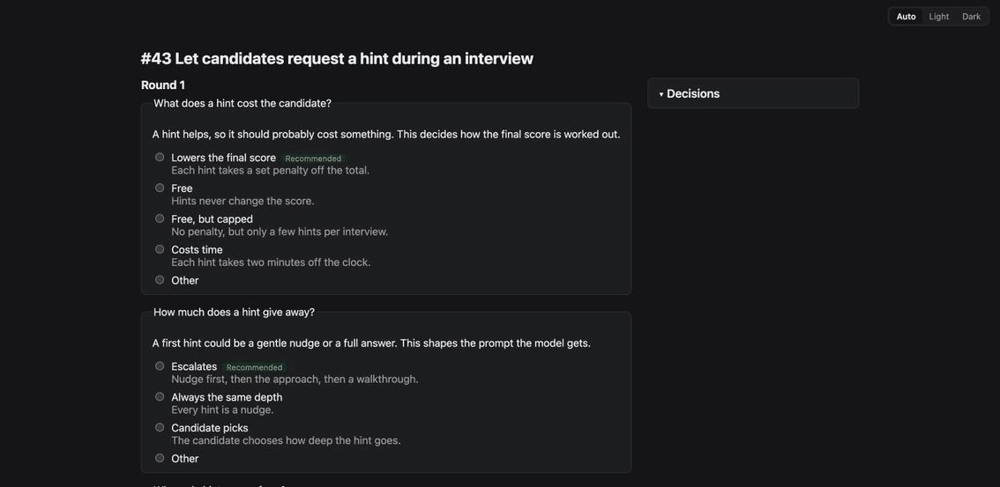
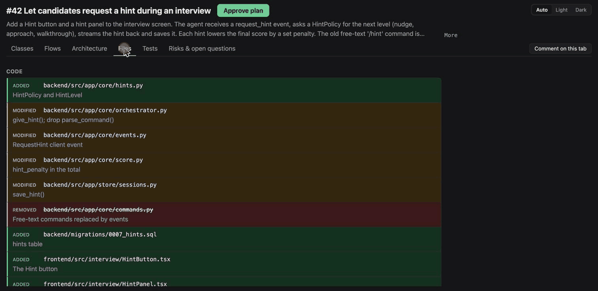

# claude-workbench

**plan-review: settle the design with your coding agent before it writes any code.** A plugin for Claude Code, OpenAI Codex and opencode.

## The problem

Give a coding agent a medium-sized change, and it decides the design on its own and hands you a large diff. By then the questions that mattered have already been answered for you: how something is scored, where a class lives, what gets removed. Reviewing a finished diff is the most expensive moment to disagree.

plan-review moves that conversation to the start. The agent asks you about the open decisions first, then shows its plan as diagrams you can comment on, and it answers or revises the plan live. Only once you approve do agents build it, test-first, and two reviewers check the result before anything is committed.

<table>
<tr>
<th width="50%">1. Settle the decisions</th>
<th width="50%">2. Review the plan</th>
</tr>
<tr>
<td><a href="docs/img/grill.gif"></a></td>
<td><a href="docs/img/plan-review.gif"></a></td>
</tr>
</table>

Click a GIF to see it full size.

## Features

- **One command** runs the whole pipeline: `/plan-review:ship <issue or prompt>`. It takes a GitHub, Jira or Linear issue (Jira and Linear through your connector for them), or a plain prompt.
- **Grill**: questions in rounds, on a page or in the chat. Each has several choices, plus a note or your own answer. The agent replies to your own answers until they are settled, and you confirm a summary of the decisions.
- **A plan as diagrams**, in tabs: classes (front end and back end), sequence diagrams and flowcharts, architecture, files, tests, and risks and open questions. Every element shows whether it is added, changed or removed.
- **Comment on anything**. Comments are drafts until you submit the review. The agent answers in the thread or revises the plan, and the page updates live and outlines what changed.
- **You approve**, once every thread is resolved. Nothing is built before that.
- **Test-first build**: the implementer follows the planned tests in order, and records each failing run as evidence.
- **Two reviewers**: one for the tests, one for the code. They run your checks and your project's rules, and loop with the implementer until they pass. A review that changes any file is thrown away, and pass or fail is decided by `plan-review`, not by the agent.
- **You stay in charge of git**: it commits only after your OK, and never pushes, merges or writes to your tracker unless you ask.
- **Your plans and decisions stay with you**: every run is saved locally in `.plan-review/work/<id>/`, including the plan, the decisions and the comment threads. Git ignores that folder by default. To keep runs in your history, edit `.plan-review/work/.gitignore`; plan-review never overwrites it.
- **Not a replacement for human review**: the agents' reviews catch a lot, but a person should still review the final change before it merges.
- **Per-project settings** in `.plan-review/config.json`: your checks, review rules, branch pattern and more. You can also use your own copy of any agent.

Every command and setting is in [plan-review's README](plugins/plan-review/README.md).

## Install and upgrade

You need macOS, Linux or Windows (with [Git for Windows](https://gitforwindows.org/)), `git`, [uv](https://docs.astral.sh/uv/) 0.13.0 or later (it fetches Python itself), and [`gh`](https://cli.github.com/) logged in for GitHub issues.

### Claude Code

Version 2.1.292 or later:

```bash
claude plugin install plan-review --marketplace Selimmo/claude-workbench
```

Then run `/reload-plugins`, and in a project:

```
/plan-review:ship <issue_id | issue_URL | "prompt"> [--grill]
```

For example:

```bash
/plan-review:ship 42 --grill                                           # a GitHub issue
/plan-review:ship https://acme.atlassian.net/browse/SHOP-128 --grill   # a Jira issue link
/plan-review:ship "Let users export their orders as CSV" --grill       # a plain prompt
```

`--grill` settles the open decisions with you before the plan is written. Leave it out to go straight to the plan.

### Codex

In OpenAI Codex:

```bash
uv tool install https://github.com/Selimmo/claude-workbench/releases/download/plan-review--v0.4.0/plan_review-0.4.0-py3-none-any.whl
plan-review install codex
```

Then run `$ship` in Codex, with the same arguments as above: `$ship 42 --grill`. Codex needs network access in its sandbox; see [plan-review in Codex](docs/codex.md).

### opencode

In [opencode](https://opencode.ai):

```bash
uv tool install https://github.com/Selimmo/claude-workbench/releases/download/plan-review--v0.4.0/plan_review-0.4.0-py3-none-any.whl
plan-review install opencode
```

Then run `/plan-review-ship` in opencode, with the same arguments as above: `/plan-review-ship 42 --grill`. See [plan-review in opencode](docs/opencode.md).

### Upgrade

Run `plan-review upgrade`. It works for each tool.

## When to use it

**Use it for medium and large changes**: several files, or a design worth agreeing on before code exists. For example, "let candidates request hints during an interview" touches the client, the agent, scoring and storage. Deciding how hints are scored, and reviewing the classes first, beats reviewing a 1,500-line diff afterwards.

**Skip it for small changes**: a one-line fix, a typo, a rename. There, the questions, the plan and two reviews cost more than they save. Just ask your agent.

## More

- [plan-review's README](plugins/plan-review/README.md): every command, the plan format, the agents and the settings
- [What it can touch](docs/what-it-can-touch.md): files, git, your tracker and permissions
- [CHANGELOG.md](CHANGELOG.md), [CONTRIBUTING.md](CONTRIBUTING.md), [RELEASING.md](RELEASING.md)
- License: [MIT](LICENSE)
