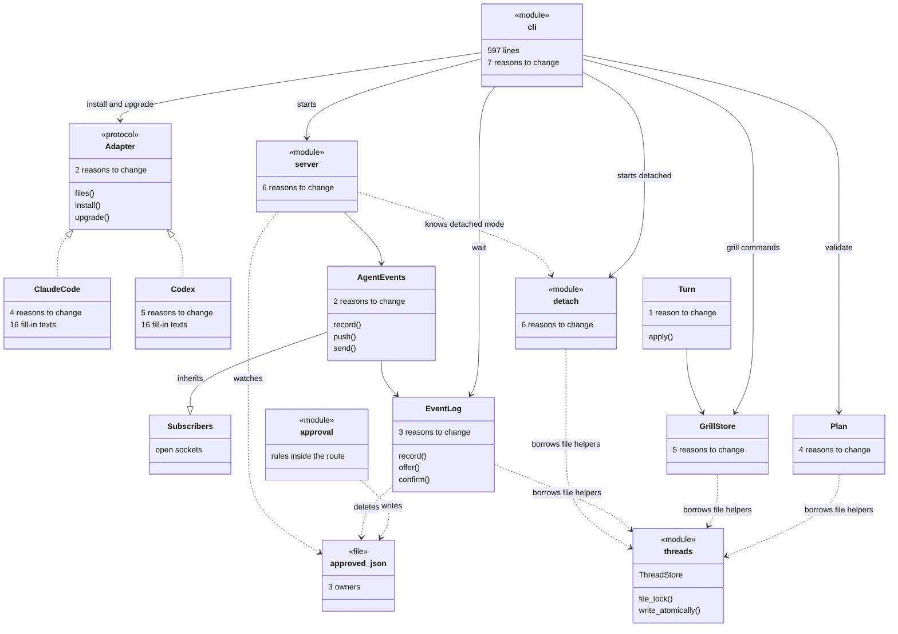
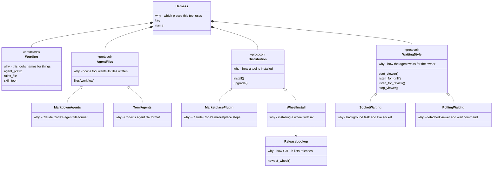
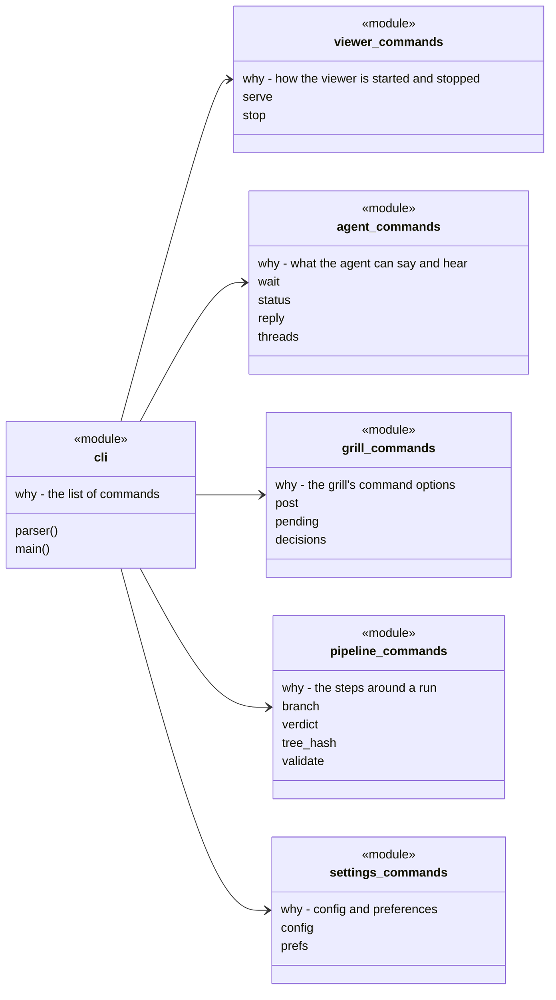
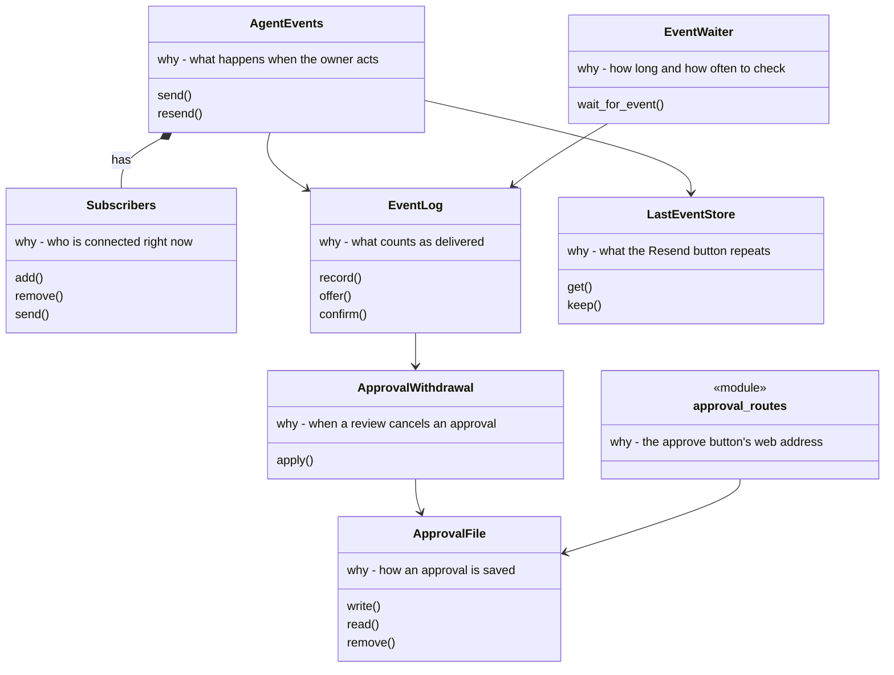
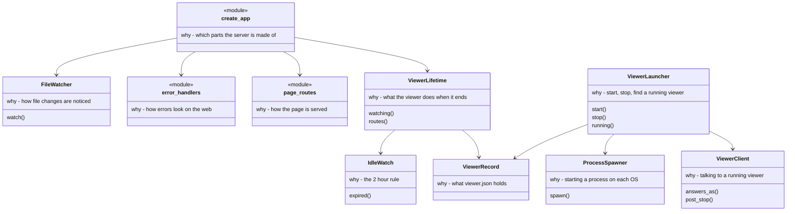
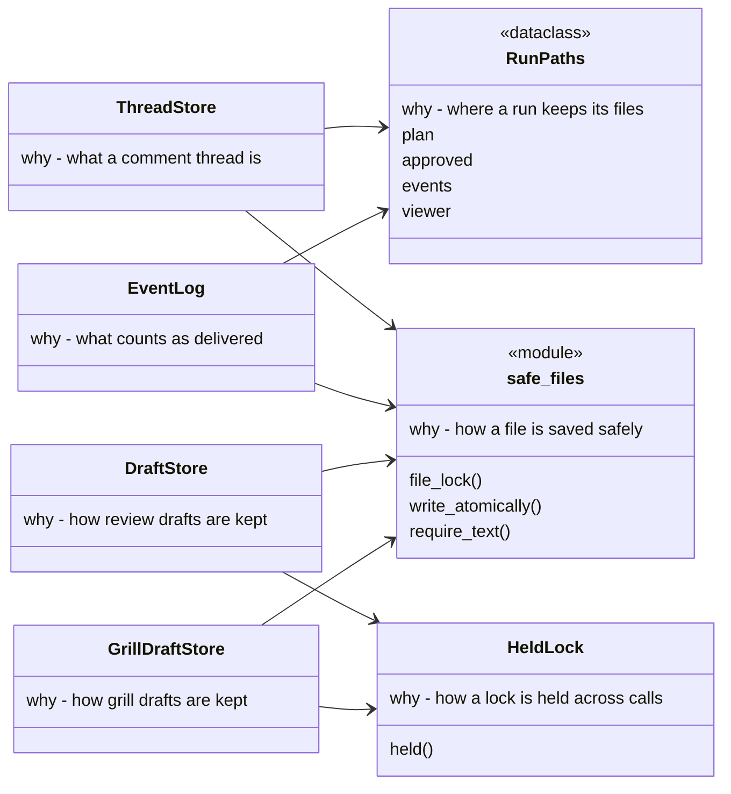
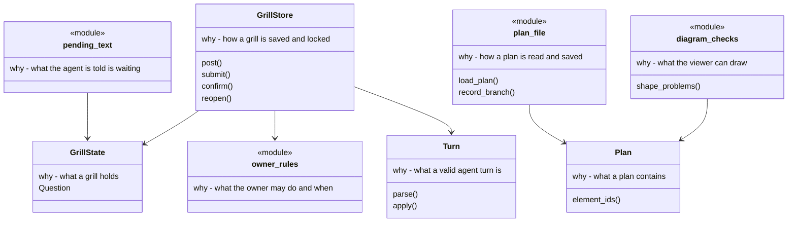
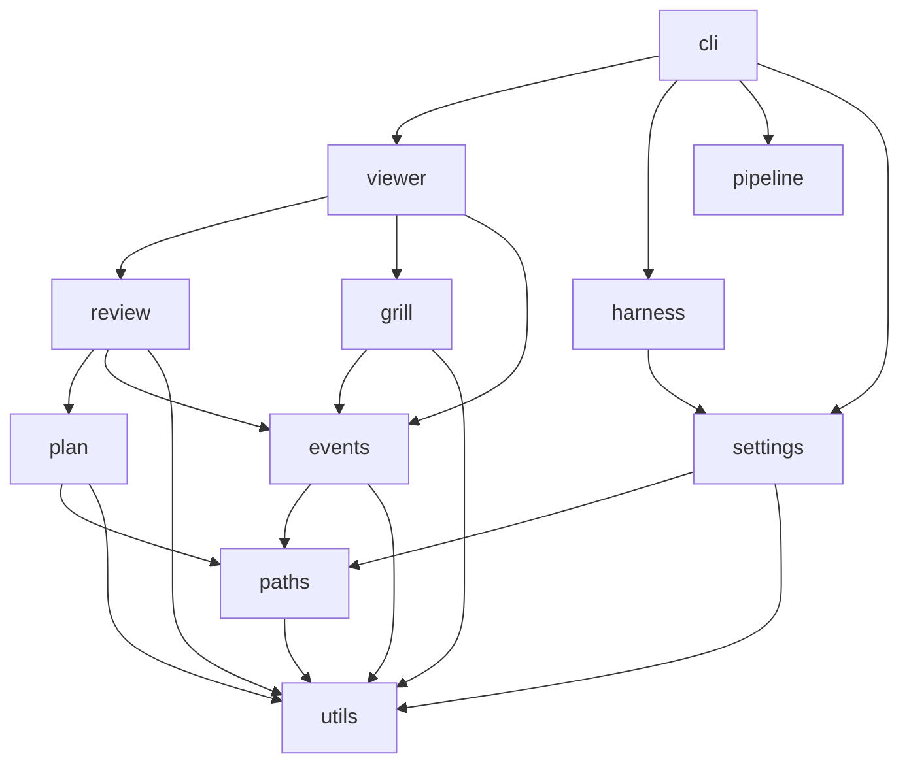

# plan-review architecture refactor

_plugins/plan-review · decisions settled · updated 10 Nov 2026_

The main parts of plan-review as they are now, how each could be split so that it has one reason to change, and the folder layout the package would end up with. Nothing here has been built yet. The decisions and the stages are at the end.

- **Each tool repeats the same choice**: Every adapter fills in 16 pieces of workflow text. Nine of them say one thing: how the agent waits for you.
- **`cli.py` has seven jobs**: Commands, starting the viewer, the agent's messages, the grill, settings and some real rules all live there.
- **The comments file is doing a second job**: Nine unrelated files import their file-saving helpers from `threads.py`, the comments module.
- **Thirty files, no folders**: Everything sits flat in `src/plan_review/`. Generic helpers and domain code share one level, so nothing shows which way dependencies may point.

## Today

Each box says how many separate reasons it has to change. Dashed arrows are dependencies pointing the wrong way, or files reaching into something that isn't theirs. Boxes marked module are plain Python functions, with no class.



## The score for each part

Measured on 9 Nov 2026, before the last fixes in #63, so the numbers are a guide. Lines and reasons come from reading the code. Hardest function is the complexipy score, where anything above 10 was flagged. The two numbers measure different things, and `grill_turn.py` shows why: it is hard to follow, yet it has one job.

| File | Lines | Reasons | Hardest function | What to do |
| --- | --- | --- | --- | --- |
| `cli.py` | 597 | 7 | 13 | Split up |
| `server.py` | 196 | 6 | ≤ 10 | Split up |
| `detach.py` | 246 | 6 | 11 | Split up |
| `adapters/codex.py` | 238 | 5 | 15 | Split up |
| `grill.py` | 276 | 5 | 19 | Split up |
| `adapters/claude_code.py` | 158 | 4 | ≤ 10 | Split up |
| `plan.py` | 345 | 4 | ≤ 10 | Move one part out |
| `event_log.py` | 118 | 3 | ≤ 10 | Move one part out |
| `harness.py` | 37 | 2 | ≤ 10 | Split up |
| `events.py` | 64 | 2 | ≤ 10 | Stop inheriting |
| `grill_turn.py` | 173 | 1 | 24 | Keep whole, simplify inside |

## How each part could split

Every box below has a line starting "why", which is its one reason to change. If you can think of a second reason for a box, that box still needs splitting.

### 1. The tools (Claude Code, Codex, the next ones)

Today one adapter mixes four jobs: its wording, its file format, how it installs, and how it waits. The protocol also forces methods that don't fit: `ClaudeCode.install` only prints a message and returns 2, and `Codex.available` always says yes.



What you gain: a new tool becomes a short list of existing pieces, plus any piece that's truly new. `Wording` as a typed object means a missing fill-in is caught before anything runs.

### 2. The command line

Today `cli.py` holds every command, and three real rules sit inside command handlers: status confirming an event, the grill's lock order, and the fallback to the chat grill.



What you gain: a new command goes in its group's file and `cli.py` stays small. These stay plain functions, because a class would add nothing. The three rules move down into the parts they belong to.

### 3. Events and waiting

Today `AgentEvents` inherits from `Subscribers` and changes what `send` means. `approved.json` has three owners, and the one that writes it doesn't write it safely.



What you gain: one owner for each file, and one place for the approval rule. Today that rule only runs when the agent uses `wait`, so it runs in Codex but not in Claude Code. Decision 3 below covers that.

### 4. The viewer process

Today `detach.py` holds both sides of a conversation: code that runs inside the viewer and code that launches it from outside. The file already has a divider between them. `server.py` mixes wiring with file watching and error handling.



### 5. Shared file handling

Today the file-saving helpers live in the comments module, and run file names are written out in about ten places. Two draft stores have copied the same locking code.



Good first step: it's small, it risks little, and it removes most of the wrong-way arrows in the first diagram. The next section makes it a real folder.

### 6. The grill and the plan

Today `grill.py` mixes the data, saving, your rules, and the text shown to the agent. `plan.py` mixes the plan's format with file access and a check on how diagrams will be drawn.



`Turn.apply`, the hardest function in the package, stays in one piece. Splitting it would only scatter one job, so it gets simplified inside instead.

## 7. Where the files end up

The splits above decide what each file is. This decides where it lives. Today all of it sits flat in `src/plan_review/`. Folders turn the dependency rule into something you can see in the file tree: code may import from folders lower in the picture and never from higher ones.

Key: **folder/** new folder; **+** new file from a split above; **← file.py** where it comes from today.

```text
src/plan_review/
├── __init__.py
│
├── utils/                      generic, imports nothing else from the package
│   ├── safe_files.py           file_lock, write_atomically      ← threads.py
│   ├── json_files.py           read_file, BrokenFile, named_errors ← file_errors.py
│   └── text.py                 require_text                     ← threads.py
│
├── paths/                      where a run keeps its files
│   ├── run_id.py               check_run_id, label              ← run_id.py
│   ├── workdir.py              work_dir, config_path, ...       ← workdir.py
│   └── + run_paths.py           RunPaths: plan, approved, events, viewer
│
├── settings/                   project config and owner preferences
│   ├── prefs.py                                                 ← prefs.py
│   ├── pipeline_config.py      PipelineConfig, load_pipeline    ← pipeline.py
│   └── migration.py                                             ← migration.py
│
├── plan/                       what a plan is
│   ├── model.py                Plan, Issue                      ← plan.py
│   ├── + plan_file.py           load_plan, record_branch         ← plan.py
│   └── + diagram_checks.py      shape_problems                   ← plan.py
│
├── review/                     comments, drafts and approval on a plan
│   ├── threads.py              Thread, ThreadStore              ← threads.py
│   ├── drafts.py                                                ← drafts.py
│   ├── service.py                                               ← review.py
│   ├── approval.py                                              ← approval.py
│   ├── + approval_file.py       the one owner of approved.json
│   └── routes.py                                                ← thread_routes.py
│
├── grill/                      the question-and-answer rounds
│   ├── state.py                GrillState, Question             ← grill.py
│   ├── store.py                GrillStore                       ← grill.py
│   ├── + owner_rules.py         what the owner may do and when   ← grill.py
│   ├── turn.py                 Turn (kept whole)                ← grill_turn.py
│   ├── drafts.py                                                ← grill_drafts.py
│   ├── routes.py                                                ← grill_routes.py
│   ├── + pending_text.py        what the agent is told is waiting
│   └── decisions_md.py                                          ← decisions_md.py
│
├── events/                     what the owner did, and who hears about it
│   ├── subscribers.py          Subscribers                      ← events.py
│   ├── agent_events.py         AgentEvents, no inheritance      ← events.py
│   ├── event_log.py            what counts as delivered
│   ├── last_event.py                                            ← last_event.py
│   ├── resend.py                                                ← resend.py
│   ├── status.py               StatusStore                      ← status.py
│   └── + waiter.py              EventWaiter
│
├── pipeline/                   the steps around a run
│   └── orchestration.py        branch_name, tree_hash, verdict  ← orchestration.py
│
├── viewer/                     the local web server and its process
│   ├── app.py                  create_app                       ← server.py
│   ├── + file_watcher.py                                         ← server.py
│   ├── + error_handlers.py                                      ← server.py
│   ├── + lifetime.py            IdleWatch, ViewerLifetime        ← detach.py
│   ├── + launcher.py            start, stop, find                ← detach.py
│   └── + client.py              talking to a running viewer      ← detach.py
│
├── harness/                    one folder per way of plugging into a tool
│   ├── harness.py              Harness: which pieces a tool uses ← harness.py
│   ├── + wording.py             Wording: a tool's names for things
│   ├── workflow.py                                              ← workflow.py
│   ├── generate.py                                              ← generate.py
│   ├── upgrade.py                                               ← upgrade.py
│   ├── adapters/               one small file per tool
│   │   ├── claude_code.py                                       ← adapters/claude_code.py
│   │   └── codex.py                                             ← adapters/codex.py
│   ├── agent_files/            markdown.py, toml.py
│   ├── distribution/           marketplace.py, wheel.py, releases.py
│   └── waiting/                socket.py, polling.py
│
└── cli/                        plain functions, one file per command group
    ├── __init__.py             parser(), main()  (entry point stays plan_review.cli:main)
    ├── viewer.py               serve, stop                      ← cli.py
    ├── agent.py                wait, status, reply, threads     ← cli.py
    ├── grill.py                post, pending, decisions         ← cli.py
    ├── pipeline.py             branch, verdict, tree_hash, validate ← cli.py
    └── settings.py             config, prefs                    ← cli.py
```

### Which way imports may point

A folder may import from the folders it points to, and from nothing higher. Nothing points back up, so `utils/` can be lifted out and still work.



### What counts as a util

- **Generic.** It could be copied into another project unchanged. It knows nothing about plans, comments, grills or runs.
- **Reused.** At least two callers. `write_atomically` has seven outside the comments module today. A helper with one caller stays next to that caller.
- **Imports nothing else from the package.** A test enforces it, in the same style as the existing `test_core_is_neutral.py`.
- **Not utils:** `run_id` and `workdir` know what a run is, so they live in `paths/`. A `utils/` folder that grows into a grab bag has stopped doing its job.

### What stays the same

- The `plan-review` command and its entry point, because `cli/__init__.py` still exports `main`.
- All behaviour. Moves go first, as their own commit made with `git mv` so history follows each file, and `check.sh` passing is the proof.
- Tests move to mirror the folders (`tests/review/`, `tests/grill/` and so on), and the README's structure section is updated in the same issue.

### What happens to the tests

Most tests call the public interface (`main([...])`, the stores, the web routes), so they keep passing through every stage. The suite has about 60 imports of `plan_review.<module>` from 24 modules, which are one-line edits, and about 15 edits that are more than that.

| Stage | Test change | Why |
| --- | --- | --- |
| Move into folders and `utils/` | Import lines, plus the patches and path strings below | No logic changes, so passing tests mean nothing broke. |
| Splits (sections 1 to 4 and 6) | Small and local | A test of a class that gets split follows the new class. Behaviour tests still cover it. |
| `cli.py` into `cli/` | The ten patches in `test_cli.py` | Patching `cli.work_dir` stops working once `work_dir` is called from `cli/viewer.py`. |

**The edits that are more than imports:**

- Patches by module name: `cli.work_dir`, `cli.ensure_work_dir`, `cli.STATIC_DIR`, `cli.run_server`, `cli.today`, `threads.REPLACE_RETRY_SECONDS`, `upgrade.PACKAGE_ROOT`, `claude_code.subprocess`.
- Path strings: `test_package.py` names `src/plan_review/cli.py`, and `test_core_is_neutral.py` walks `src/plan_review`.

**Two habits keep this small:**

- Each folder's `__init__.py` re-exports its public names, so `from plan_review.review import ThreadStore` works. Don't keep old module names like `plan_review.threads` as aliases, because that hides the new layout.
- Patch where a name is used, not where it is defined. For the `cli` patches, pass `work_dir`, `today` and the server launcher into the command functions as arguments, with the real ones as defaults. Then `main` is the only entry point and tests don't depend on module internals.

The check: `check.sh` passes after the move commit with no assertion changed. If an assertion has to change, that commit has gone beyond a move.

What you gain: opening the package shows the product's parts at a glance. A new tool goes in `harness/adapters/`, a new command in `cli/`, and a new generic helper has an obvious home.

## 8. Branching and release

The whole refactor lives on one long branch, `refactor-structure`, and nothing reaches `main` until the end. Merging to `main` does not release: a release only happens when the owner runs `release.sh`, which tags a version and builds the zip.

- **One branch per stage.** Each stage (the folder move, then sections 1, 2, 3, 4 and 6) is a short branch named `<issue#>-slug`, forked from `refactor-structure` and merged back into it by a pull request. Each stage gets its own diff and can be reverted on its own.
- **Folder move first.** It touches about 60 import lines, so it goes in before any logic moves and later diffs show only logic.
- **One version bump, at the start.** `scripts/version-guard.sh` fails a pull request when shipped files (`src` among them) changed since the tag of the version in `plugin.json`, and that is 0.3.0 today, already released. The first commit on the long branch runs `scripts/set-version.sh` with the next version. From then on the guard says "not released yet" and passes, so one bump covers every stage. It is a number in a file and releases nothing.
- **Release when you choose.** After the final merge, `release.sh` run from `main` releases the version the branch already set, with no extra commit. Notes stay under `Unreleased` in the changelog until then.
- **No fork.** Work in this repo, not a fork. Issues and `Closes #N` stay with the code, and CI and releases behave as they do for any branch. The only way to ship by accident is to push a `plan-review--v*` tag from the branch, so don't.
- **Run the branch after each stage.** Before a stage merges into `refactor-structure`, build the viewer page (`npm --prefix plugins/plan-review/web run build`) and start Claude Code with `claude --plugin-dir <clone>/plugins/plan-review`, as CONTRIBUTING.md describes. That runs the branch's plugin while normal sessions keep the released install. For a closer test, `scripts/package.sh` builds the release zip from what is checked out, which can be unpacked into a throwaway Claude Code config. This is an acceptance criterion for every stage issue. The upgrade path from the released version can only be proven after the real release.
- **Final merge.** One pull request from `refactor-structure` into `main`, merged as a merge commit and not a squash, so each stage stays visible in history.
- **Keep up with `main`.** Merge `main` into the long branch regularly. The folder move conflicts with almost any change under `src/plan_review/`, and a hotfix released from `main` needs a different version from the one on the branch.

## Leave alone

- `grill_turn.py`: one job. Simplify it, but don't split it. It moves to `grill/turn.py` unchanged.
- `workflow.py`, `generate.py` and `upgrade.py`: small, with one job each. They only change folders.
- The web page: `api.ts` and the hooks are fine. The only clean-up is the update wiring repeated in three places.

Two small moves don't need a diagram: the web routes come out of `status.py`, and the approval rules come out of the route body in `approval.py`.

## Stages

In this order, each on its own short branch merged into `refactor-structure`.

| Stage | Work | Sections | Done when |
| --- | --- | --- | --- |
| 1 | Move into folders, add `utils/` and shared file handling | 7, 5 | `check.sh` passes with no test assertion changed |
| 2 | Split each tool into its pieces | 1 | Adding a tool touches only its own files |
| 3 | Split `cli.py` into `cli/` | 2 | Commands behave the same |
| 4 | Events: one owner for each file, one shared path | 3 | Both tools record events the same way |
| 5 | Viewer process and server | 4 | A detached viewer behaves the same |
| 6 | Grill and plan, simplify `Turn.apply` | 6 | Behaviour unchanged, complexity down |
| 7 | One merge to `main`, then release when the owner chooses | 8 | Upgrade proved after the release |

## Decisions

1. **Should classes be used only where they earn it?** SOLID talks about classes, but much of this is plain Python functions. Decided: yes. Use a class where there's saved state or swappable versions, as in sections 1, 3 and 4, and a small module of functions everywhere else, as in section 2.

2. **Should adding a tool only touch its own files?** That would be the test the refactor has to pass. It holds if the new tool can use one of the two waiting styles. Decided: yes, with a brand-new waiting style counting as one extra new file.

3. **Should both waiting styles share one path?** Today Claude Code also writes `events.json`, which nothing reads there, and the rule that a review cancels an approval only runs for Codex. Decided: one shared path for recording events and applying the rule, with the two styles differing only in how the news reaches the agent.

4. **Should the package move into folders, with a `utils/` for generic helpers?** It makes the dependency rule visible and gives each split a place to land. Decided: yes, as the very first change, before any logic moves, so later diffs show only logic.

5. **What order?** Decided: the folder move and `utils/` (sections 7 and 5), then sections 1 and 2, then 3, 4 and 6. The folder move plus shared file handling is the safest start, the tools give the most value, and the rest can follow one issue at a time.

6. **Should the work live on one long branch in this repo, merged to `main` once when everything is done, and not in a fork?** Nothing ships from a branch or from `main`: a release only happens when the owner runs `release.sh` on a clean `main`, so a long branch can't reach users. A fork would split the issues and `Closes #N` from the code, turn the release workflow into a test release, and add a second merge. Decided: one long branch, `refactor-structure`, in this repo, with a short branch per stage merged into it, and a single merge to `main` at the end. Don't tag from the long branch, and merge `main` into it regularly. Section 8 has the details.
